# Data Exploration

Ad-hoc exploration of the market data (price ticks, schemas, gaps, value
ranges) before it is built into the ingestion and streaming code.

Notebooks and scripts here are throwaway analysis, not production code.
Never commit API keys or raw data dumps; read credentials from environment
variables.

## Scripts

Run from the repo root. The three version folders share the original plots
01–04; additional comparisons live in `v3_dark/`, while the Microsoft epic
uses standalone scripts directly in `data_exploration/`.

- `v1_basic/`: first version, CI colors and font only.
- `v2_polished/`: title and subtitle at the left edge instead of axis titles,
  German month names and number format, a labeled dot on the last value,
  legend as one row above the plot, a card behind the chart.
- `v3_dark/`: same as v2, permanently in the CI default mode (`meta.default_mode`
  in the JSON, currently dark). Plain file names, no switch needed.

| Script (in every folder) | Output |
|---|---|
| `01_plot_price_eur.py` | `01_price_eur.png`: MSFT price in EUR, year to date |
| `02_plot_price_earnings.py` | `02_price_earnings.png`: same price with quarterly EPS surprise markers |
| `03_plot_cashflow.py` | `03_cashflow.png`: operating cash flow, capex, free cash flow per quarter (USD) |
| `04_plot_candles.py` | `04_candles.png`: MSFT daily candles of the last 60 trading days with SMA 20/50 and a volume panel |

Example: `python data_exploration/v3_dark/01_plot_price_eur.py`

Dark mode in v2: `CI_MODE=dark python data_exploration/v2_polished/01_plot_price_eur.py`
writes `01_price_eur_dark.png` next to the light version.

Each folder has its own `ci.py` (`use_ci()` and, from v2 on, the layout helpers);
the values come from `style/felix-schramm-ci.json`.

Requirements: `pip install yfinance matplotlib`

## Additional dark-mode comparisons

| Script | Output | Content |
|---|---|---|
| `v3_dark/05_plot_indexed.py` | `v3_dark/05_indexed.png` | ORCL, MSFT, 9988.HK, SAP.DE adjusted USD closes over one year, indexed to 100 at their first common close |
| `v3_dark/06_plot_monthly_returns.py` | `v3_dark/06_monthly_returns.png` | Twelve complete months of returns; nine signed color bins |
| `v3_dark/07_plot_drawdown.py` | `v3_dark/07_drawdown.png` | Drawdown from each stock's running high within the displayed year |
| `v3_dark/08_plot_kpi_tiles.py` | `v3_dark/08_kpi_tiles.png` | Last adjusted close, daily/year return, annual log volatility and maximum drawdown |

Run from the repository root, e.g.
`python data_exploration/v3_dark/05_plot_indexed.py`. The comparison uses a
common trading calendar for the indexed comparison and stops if any requested
price series is missing.

Charts comparing three or more stocks use only stocks from the owner's
actual portfolio. The shared approved selection is in `v3_dark/stocks.py`:
Oracle (`ORCL`, slot 1), Microsoft (`MSFT`, slot 2), Alibaba Hong Kong
(`9988.HK`, slot 3), SAP Xetra (`SAP.DE`, slot 4). The shared `load_history`
loader divides HKD prices by `USDHKD=X` and multiplies EUR prices by `EURUSD=X`.
Only FX gaps are forward-filled. Stock prices retain their native calendars;
monthly returns, drawdown and volatility use each listing's actual observations.
The indexed comparison alone aligns prices on common trading dates.
The indexed chart, monthly returns, drawdown, KPI tiles
and HTML preview use this selection and keep each stock's color fixed.
Check the private portfolio source before adding or replacing a symbol;
watchlist entries and synthetic demo positions are not holdings. Do not
commit spreadsheet identifiers, quantities, weights or cost bases.

## Microsoft business and market charts

These standalone scripts reuse the dark CI from `v3_dark/ci.py`. Each command
fetches real Yahoo data and writes its PNG next to the script. For example:

```sh
python data_exploration/04_plot_cashflow_annual.py
python data_exploration/14_plot_implied_vol.py
```

| Script | Output | Content |
|---|---|---|
| `04_plot_cashflow_annual.py` | [04_cashflow_annual.png](04_cashflow_annual.png) | Operating cash flow, positive capex and free cash flow by fiscal year, billion USD |
| `05_plot_income.py` | [05_income.png](05_income.png) | Quarterly revenue/net income and separate net/operating margin panel |
| `06_plot_earnings_reaction.py` | [06_earnings_reaction.png](06_earnings_reaction.png) | EPS surprise versus the strictly next trading day's close return |
| `07_plot_pe_ratio.py` | [07_pe_ratio.png](07_pe_ratio.png) | Historical P/E using the sum of four consecutive reported adjusted EPS |
| `08_plot_benchmark.py` | [08_benchmark.png](08_benchmark.png) | MSFT versus S&P 500 and Nasdaq-100, with a separate MSFT drawdown panel |
| `09_plot_dividends.py` | [09_dividends.png](09_dividends.png) | Dividend per share and trailing twelve-calendar-month dividend yield |
| `10_plot_analysts.py` | [10_analysts.png](10_analysts.png) | Current target range, mean/median and recommendation counts |
| `11_plot_price_targets.py` | [11_price_targets.png](11_price_targets.png) | Individual analyst target actions on the year-to-date price chart |
| `12_plot_insiders.py` | [12_insiders.png](12_insiders.png) | Insider trades by type and reported value; markers at daily closes |
| `13_plot_holders.py` | [13_holders.png](13_holders.png) | Ten largest reported institutional holders, with filing dates and changes |
| `14_plot_implied_vol.py` | [14_implied_vol.png](14_implied_vol.png) | Call IV by strike for three expiries around 7, 30 and 90 days |

### Data conventions and limits

- Multi-stock comparisons use adjusted closes. MSFT price/EPS/target/dividend
  charts use unadjusted USD closes. The benchmark compares price returns with
  price indices, without dividend reinvestment or EUR conversion.
- After-close EPS are available for P/E only from the next trading session.
  Missing quarters do not count as four consecutive quarters. Adjusted reported
  EPS differ from GAAP earnings used by some finance portals.
- Financial statements include only complete reported periods. Microsoft's
  fiscal year ends in June. Statement history is limited by Yahoo coverage.
- Dividend yield uses actual payments in `(date − one calendar year, date]`,
  not an annualized forecast. The full dividend history supplies the first
  displayed year's trailing payments.
- Analyst summaries, institutional holders and options are snapshots. Filing
  dates can lag the retrieval date. Analyst action markers are individual
  reports, not a historical consensus series.
- Insider marker area is proportional to positive reported USD value. Zero or
  unknown values use small outlined markers. Their y-position is the daily
  close, not the transaction execution price.
- Options use calls within ±20% of the last close, positive open interest,
  finite IV above 1%, and a last trade within seven calendar days. Weekend
  quotes can still be stale. Scripts fail clearly when required data is absent;
  they do not manufacture replacement data.

Regenerate all additional charts from the repository root:

```sh
for script in data_exploration/[0-9][0-9]_plot_*.py data_exploration/v3_dark/0[5-8]_plot_*.py; do
    python "$script" || break
done
python -m unittest discover -s tests -v
```

### Preview gallery

The committed PNGs were generated from real market data on 2026-11-01.
Click any preview to open the full image.

| Price comparison | Monthly returns | Drawdown |
|---|---|---|
| [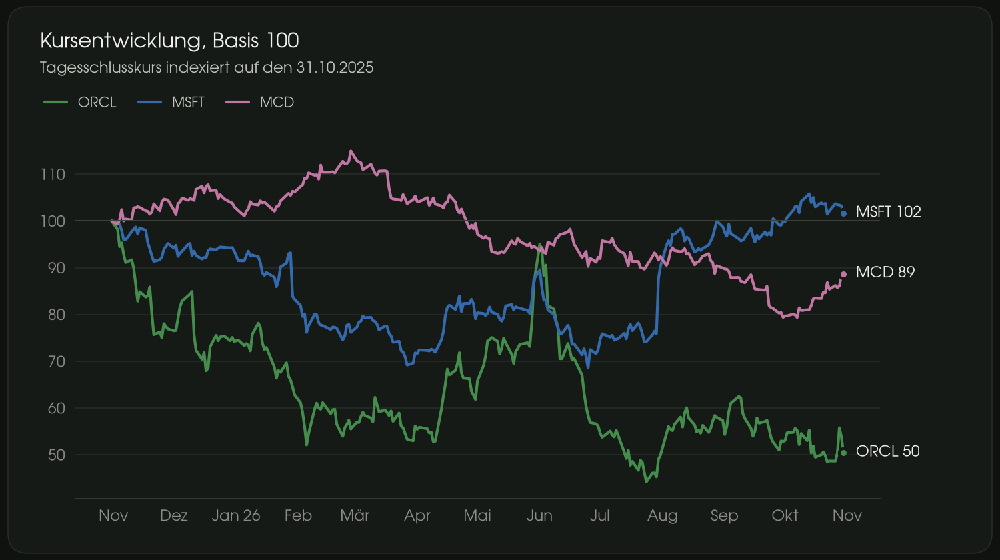](v3_dark/05_indexed.png) | [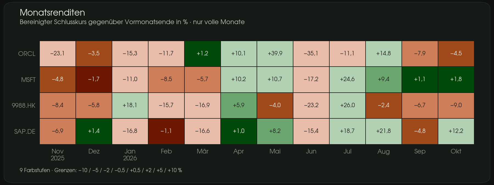](v3_dark/06_monthly_returns.png) | [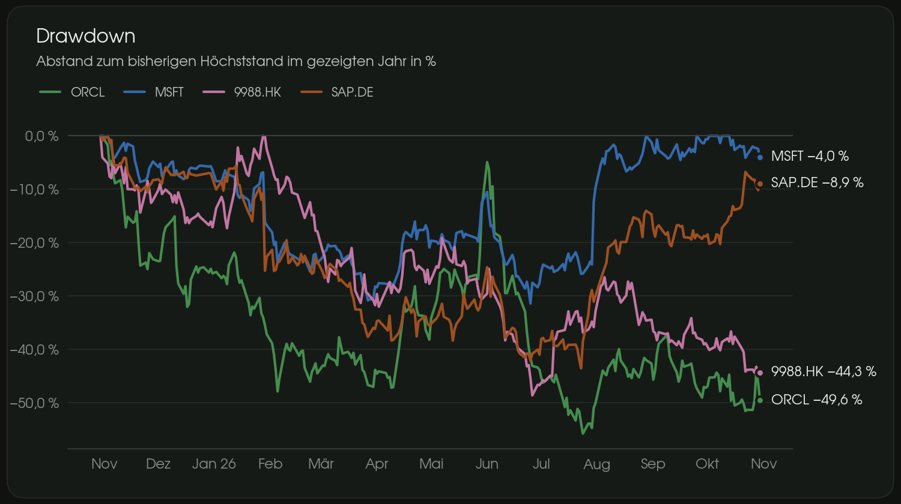](v3_dark/07_drawdown.png) |

| KPI tiles | Annual cash flow | Quarterly income |
|---|---|---|
| [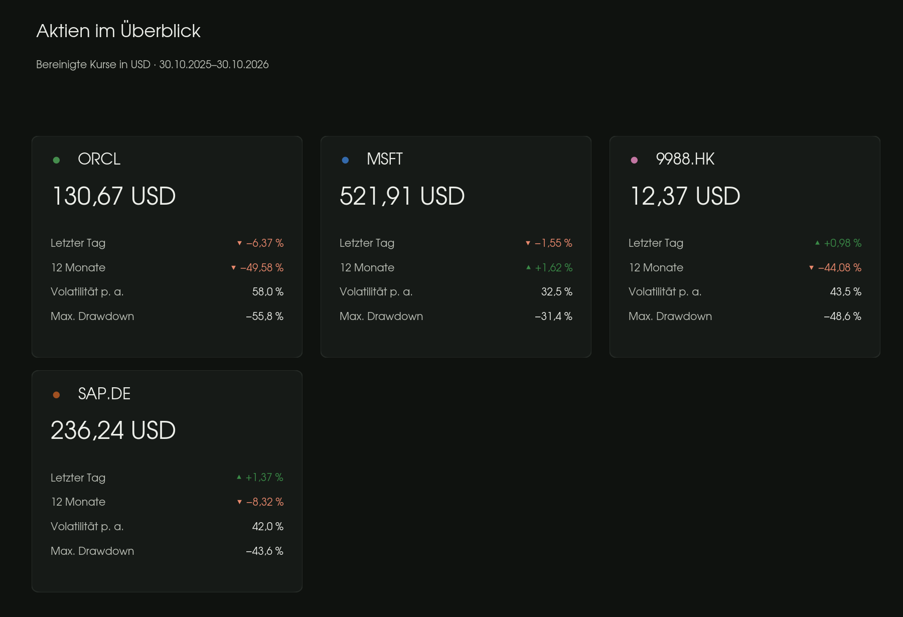](v3_dark/08_kpi_tiles.png) | [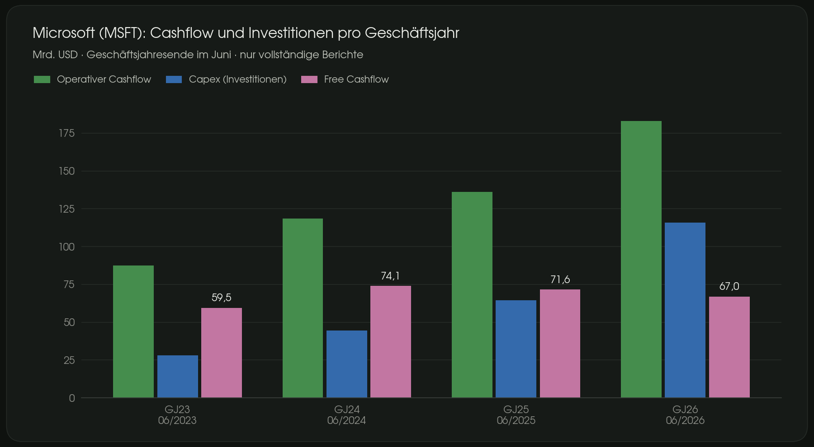](04_cashflow_annual.png) | [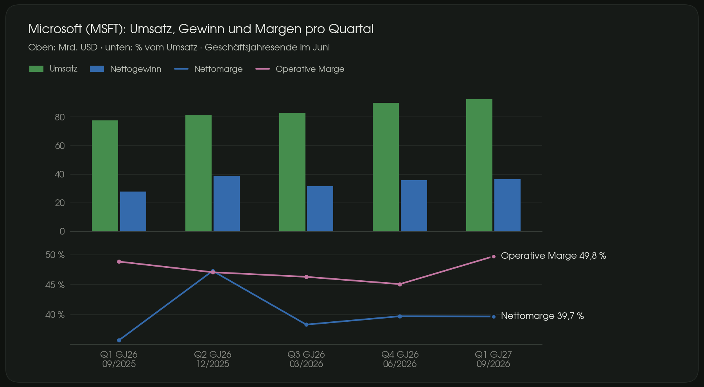](05_income.png) |

| Earnings reaction | Historical P/E | Benchmark |
|---|---|---|
| [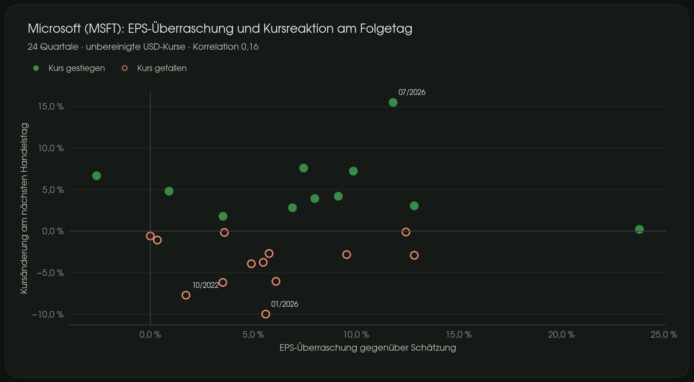](06_earnings_reaction.png) | [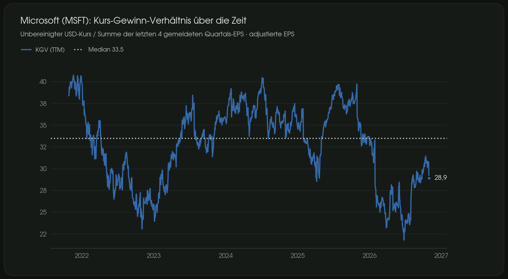](07_pe_ratio.png) | [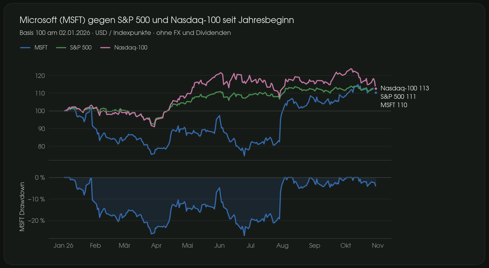](08_benchmark.png) |

| Dividends | Analyst snapshot | Target actions |
|---|---|---|
| [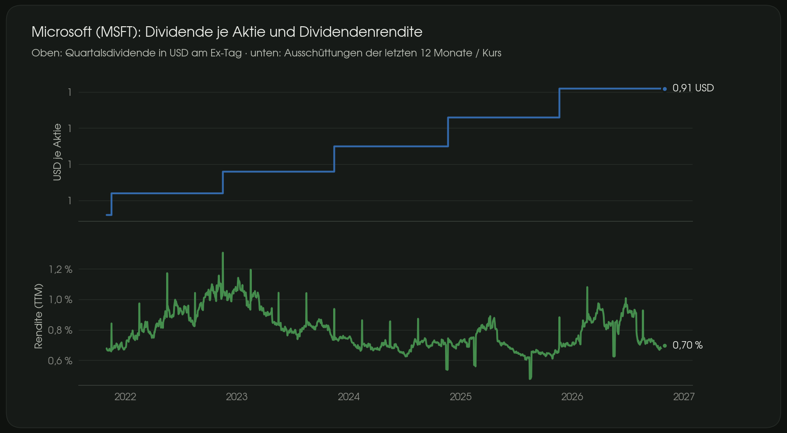](09_dividends.png) | [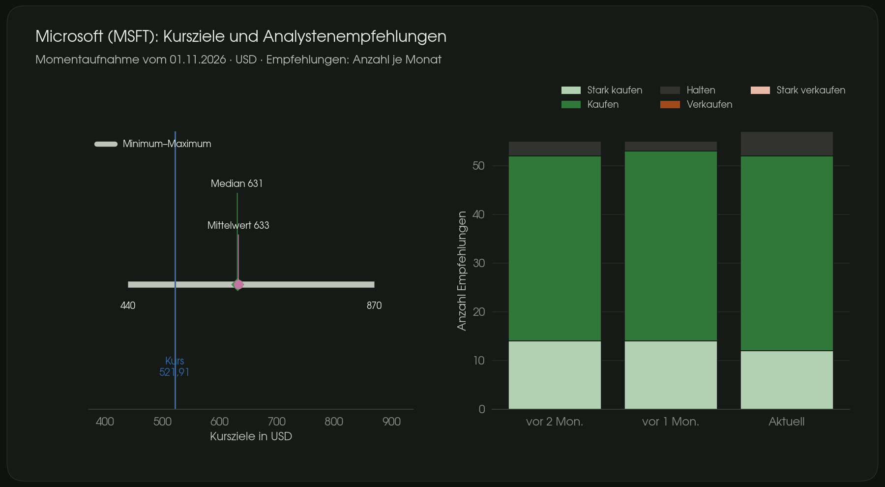](10_analysts.png) | [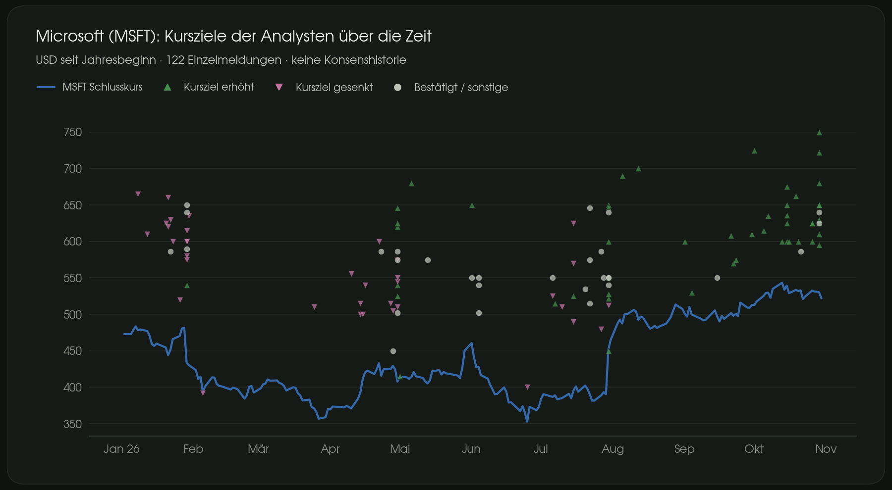](11_price_targets.png) |

| Insider transactions | Institutional holders | Implied volatility |
|---|---|---|
| [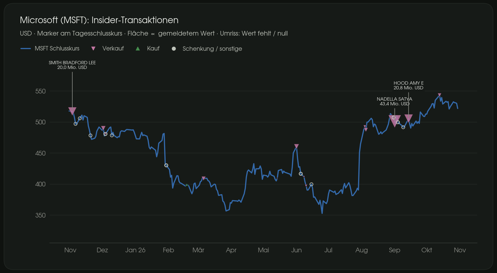](12_insiders.png) | [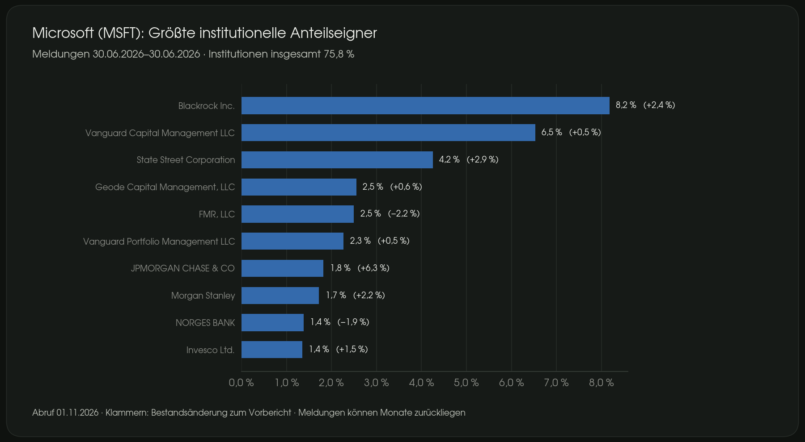](13_holders.png) | [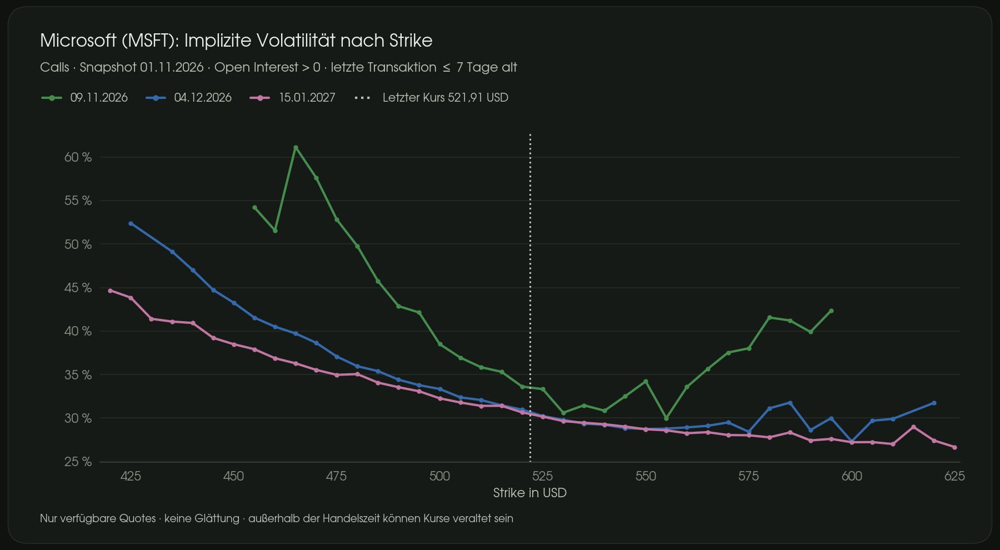](14_implied_vol.png) |

Current owner workflow: publish checked work directly to `main`, without a
separate PR or review, and show updated chart images in chat.
